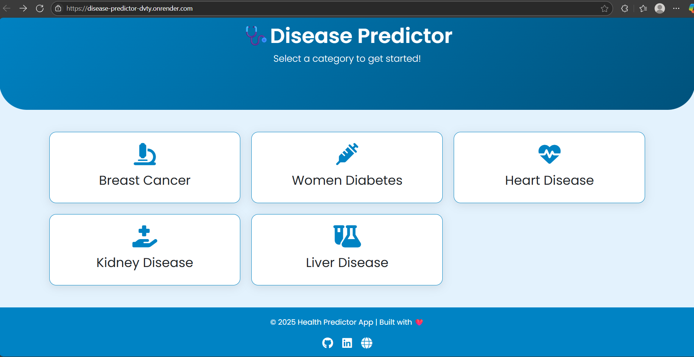
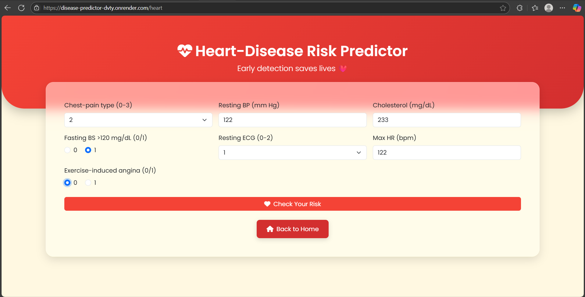
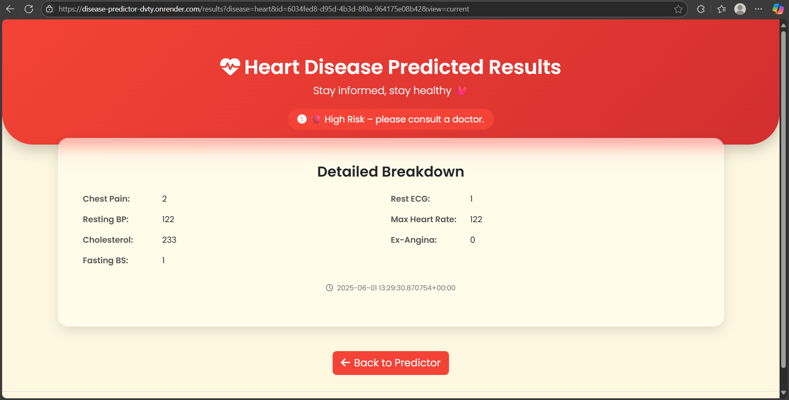

# 🧠 Disease Predictor: Multi-Disease ML Prototype

An educational, modular **machine-learning prototype** that demonstrates prediction workflows for **five disease categories**:

- ❤️ Heart Disease
- 🎗️ Breast Cancer
- 🧪 Kidney Disease
- 🧬 Liver Disease
- 🍭 Diabetes (for women)

The repository contains disease-specific data ingestion, validation, transformation and training components, along with saved model artifacts and a Flask demonstration interface. The workflows are experimental and are not validated for clinical use.

🌐 **Live App:** [Try it on Render](https://disease-predictor-j8m7.onrender.com/)

> **Safety notice:** This is an educational software demonstration, not a medical device, diagnostic service or clinical decision-support system. Its outputs are not medical advice and must not be used to diagnose, treat or make healthcare decisions. Do not submit real patient or personally identifiable health information.

> **Web-entrypoint privacy:** The configured Render service runs the repository-root `app.py` entrypoint. It validates required numeric inputs, rejects non-finite values, renders only the current result, and does not write screening submissions to disk. The `/results` history route is disabled. Separate legacy Flask scripts under `healthapp/<Disease>/app.py` have not received the same review and should not be used with real health data. This change does not remove any pre-existing `Results/` files from Git; review those separately before using the repository publicly.

---

## ✨ Key Highlights

- 🔁 **Modular architecture** for each disease
- 🧪 Custom ML pipelines: ingestion → validation → transformation → training
- 🧬 Schema validation and data drift detection
- 📈 **MLflow** for experiment tracking
- 📦 Version control for model/data via **DagsHub**
- 🧾 Clean and responsive UI (HTML, CSS, Bootstrap)
- 🌍 RESTful backend with Flask, deployed via **Waitress + Render**
- 📊 Logging & error tracking with custom exception handling

---

## 🏗️ Project Architecture

```
healthapp/
├── Cancer/         # Full pipeline and logic for breast cancer prediction
│   ├── components/ # ingestion, validation, transformation, training
│   ├── utils/      # metric calculators, estimators
│   └── app.py      # Flask route
├── Diabetes/
├── Heart/
├── Kidney/
├── Liver/
├── app_logging/    # Logger utility
├── exception/      # Custom exception classes
├── main.py         # Main training/inference entrypoint
├── templates/      # HTML templates
├── static/         # CSS, images
└── ...
```

Each disease directory includes:
- `data_ingestion.py`
- `data_validation.py` (+ drift report)
- `data_transformation.py`
- `model_trainer.py`
- `schema.yaml`, constants, config entities

---

## 🔧 Tech Stack

| Category             | Technologies Used                                      |
|----------------------|--------------------------------------------------------|
| **Frontend**         | HTML, CSS, Bootstrap                                   |
| **Backend**          | Flask, Waitress (local), Gunicorn (Render)              |
| **ML Libraries**     | scikit-learn, pandas, NumPy, matplotlib                |
| **Pipeline Modules** | Modular Python (custom components per disease)         |
| **Tracking**         | MLflow, DagsHub, PyYAML                                |
| **Database**         | MongoDB (via PyMongo), certifi                         |
| **ETL Pipeline**     | Python with schema validation + drift detection        |
| **Deployment**       | Render (WSGI via Waitress)                             |
| **Utilities**        | python-dotenv, logging, exception handling             |

---

## 🚀 Quick Start (Local Development)

```bash
git clone https://github.com/SamyakAnand/Disease-predictor.git
cd disease-predictor
pip install -r requirements.txt
python app.py
```

Access via browser at: `http://127.0.0.1:8080/`

---

## 🧪 Automated checks

Install the lightweight web-test dependencies and run the request-validation suite:

```bash
pip install -r requirements-test.txt
pytest -q
```

The tests use mocked model artifacts; they verify the web input contract and privacy behavior, not model accuracy or live database connectivity.

---

## 🧠 Supported Diseases & Models

| Disease          | Pipeline             | Output     |
|------------------|----------------------|------------|
| Heart Disease    | Custom ML pipeline   | Low/High   |
| Breast Cancer    | Custom ML pipeline   | Low/High   |
| Kidney Disease   | Custom ML pipeline   | Low/High   |
| Liver Disease    | Custom ML pipeline   | Low/High   |
| Diabetes (Women) | Custom ML pipeline   | Low/High   |

---

## 🔗 ML System Integration

- **ETL pipeline**: Extract from MongoDB → Validate (schema + drift) → Transform → Train
- **MLflow & DagsHub**: Model tracking, artifact versioning
- **Modular Design**: Each disease is a fully independent, pluggable module

---

## 🗃️ Screenshots

**🔹 Homepage**


**🔹 Prediction Form**


**🔹 Prediction Output**


---

## 📈 Future Enhancements

- 👥 Authenticated, consent-based prediction history with retention controls
- 📁 CSV upload for batch prediction
- 🔍 Model explainability (SHAP, feature importance)
- 🧔 Models for male-specific conditions
- 📊 Monitoring dashboards

---

## 👨‍💻 Author

**Samyak Anand**  
Aspiring Data Scientist | Hyderabad, India  
[🔗 LinkedIn](https://www.linkedin.com/in/SamyakAnand/)  
[💻 GitHub](https://github.com/SamyakAnand)

---

## 📝 License

Distributed under the **MIT License** – free for personal, academic, and commercial use with attribution.


